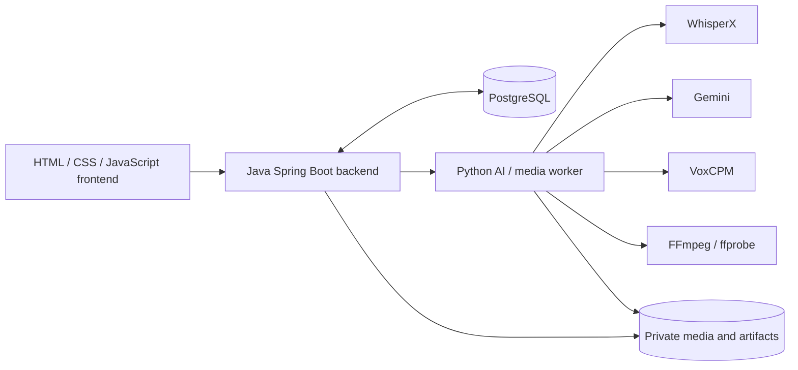
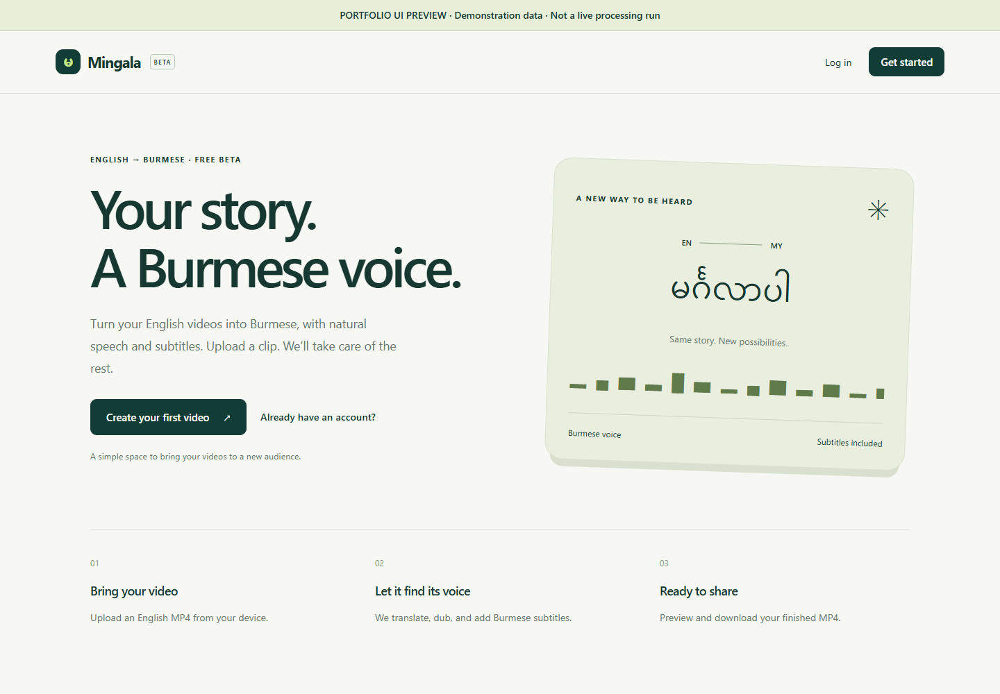
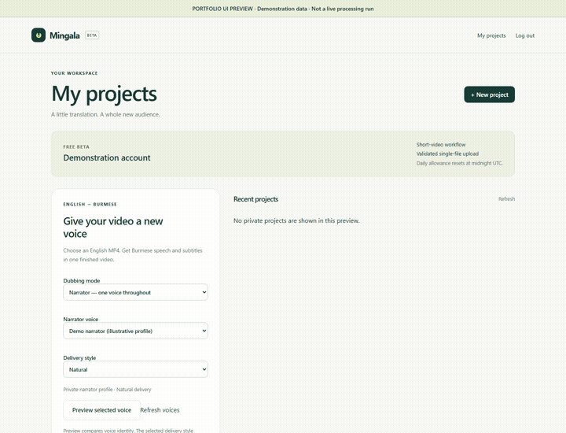

# Burmese Video Localization Platform

**A production-oriented web platform for bringing narrated video content to Burmese-speaking audiences.**

Video upload → transcription → Burmese localization → narration generation → synchronization → subtitle/media composition → final MP4.

Authorized custom-voice narration is implemented alongside three built-in narrator profiles. This repository documents the engineering; it is not a runnable distribution of the application.

## Why I built it

The goal is to make video content more accessible to Burmese-speaking audiences while exploring a real product, rather than stopping at a model demo. The work combines backend/API engineering, private media workflows, AI inference and deterministic audio/video processing.

## Implemented capabilities

- Authenticated accounts, project workflows and exactly-one-original-video upload enforcement.
- Three built-in narrator profiles and private, authorized custom voices with consent attestation, validation, preview and selection.
- Burmese localization, narration planning, voice-consistent synthesis and measured audio synchronization.
- Burmese subtitles with font, size, color and position controls; watermark and blur configuration.
- Background-audio handling, narration mixing and MP4 rendering.
- Asynchronous progress/status, eligible retry/resume, compatibility fingerprints and per-unit checkpoint reuse.
- Owner-protected result preview/download, cross-user access protection, upload validation and resource quotas.

These capabilities have different verification scopes: earlier real video runs, current automated regressions, browser/control-plane checks and deterministic render checks. They are **not** a claim that every current option has passed one fresh deployed E2E. See [testing and reliability](docs/TESTING_AND_RELIABILITY.md).

## Architecture

Spring Boot owns authentication, authorization, projects, persistence, jobs, quotas and API orchestration. Python runs the ML/audio/video tooling because WhisperX, PyTorch and VoxCPM are Python-native.

[Architecture and service boundaries →](docs/ARCHITECTURE.md)

## Technology

| Area | Stack verified in the private project |
|---|---|
| Backend | Java 21, Spring Boot 4.1.1, Maven |
| Persistence | PostgreSQL, Flyway |
| Worker | Python 3.12, FastAPI |
| AI | WhisperX, Gemini, VoxCPM, PyTorch |
| Media | FFmpeg, ffprobe |
| Frontend | HTML, CSS, JavaScript |
| Packaging | Docker, Docker Compose |

Versions are listed only where confirmed; this is not an installation guide or a published dependency lock.

## Processing and reliability

Upload → extraction → transcription → localization → narration planning → TTS → synchronization → subtitles/background composition → final render.

Duration-aware localization aims for concise, faithful narration. Final timing decisions use measured audio rather than estimates. Checkpoints, bounded retries, execution fingerprints and per-unit reuse preserve compatible work across supported recovery paths.

[Processing pipeline →](docs/PROCESSING_PIPELINE.md) · [Engineering decisions →](docs/ENGINEERING_DECISIONS.md)

## Security and testing

The application uses owner-scoped resources, private voice references/results, validated uploads, quotas and protected worker communication. Security/dependency reviews are documented internally; no claim is made that the product is vulnerability-free.

Recorded evidence includes **156 Java security/HTTP tests**, **124 Python worker security/recovery tests**, **42 frontend tests**, **12 release-contract tests** and **10 deployment-contract tests**. A later focused model-boundary/adapter run passed **58 tests**, overlapping other suites. These are separately recorded runs, not additive coverage or a fresh release certification.

[Security overview →](docs/SECURITY_OVERVIEW.md) · [Evidence and limitations →](docs/TESTING_AND_RELIABILITY.md)

## Product screenshots and UI walkthrough

These captures use the actual frontend with controlled demonstration data. Every screen is marked as a portfolio preview. The progress and completed-result views are **illustrative UI states**, not evidence of a new processing run; the result uses a labeled media placeholder.

| Screen | Public-safe capture |
|---|---|
| Dashboard / narrator selection | [View screenshot](assets/dashboard.png) |
| Subtitle and branding configuration | [View full settings panel](assets/configuration.png) |
| Custom voice / permission workflow | [View screenshot](assets/custom-voice.png) |
| Processing progress | [View illustrative state](assets/progress.png) |
| Completed-result layout | [View illustrative state](assets/result.png) |

Watch the short UI screenshot walkthrough

Silent slideshow of public-safe screenshots, not a live interaction or generated narration demo.

[Capture notes and full gallery →](assets/README.md). A public real narration/video sample remains pending separate content and voice-publication approval. No private recording, test video or verification screenshot is included.

## Status and source availability

**Private-beta / pre-release, as of 31 October 2026.** Local application security has been cleared for the invited private beta, subject to documented time-limited dependency risk acceptance. Final release-image acceptance and a fresh current-version server-side E2E remain pending adequate hardware and deployment preparation. The product is not presented as publicly launched or proven at production scale.

Production source code is kept private because this project is being developed as a commercial product. This repository contains architecture and engineering documentation for portfolio and recruiting purposes; public-safe UI screenshots are included, while a real media demonstration remains pending separate approval.

## My role

I own product direction, architecture decisions, backend/API design, AI/media integration, reliability/security tradeoffs, testing and deployment preparation. Development has been AI-assisted; my contribution is engineering ownership, implementation direction, validation and review—not a claim that I manually authored every line.

For the most useful technical starting points: [decisions](docs/ENGINEERING_DECISIONS.md), [recovery](docs/PROCESSING_PIPELINE.md#reliability-and-recovery) and [test evidence](docs/TESTING_AND_RELIABILITY.md).

## License scope

The existing [MIT license](LICENSE) covers material published in this showcase repository. The private production source is not included or offered under this repository's license.
