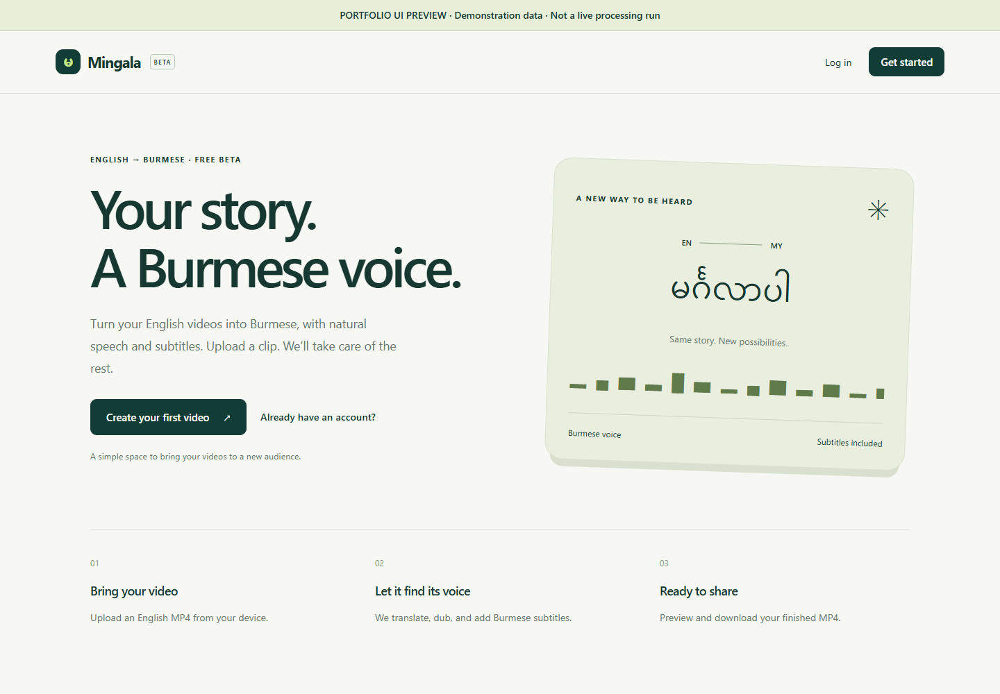
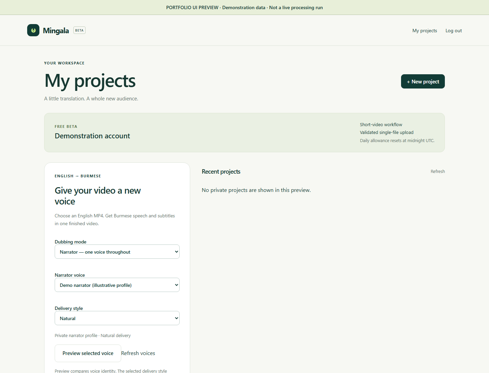
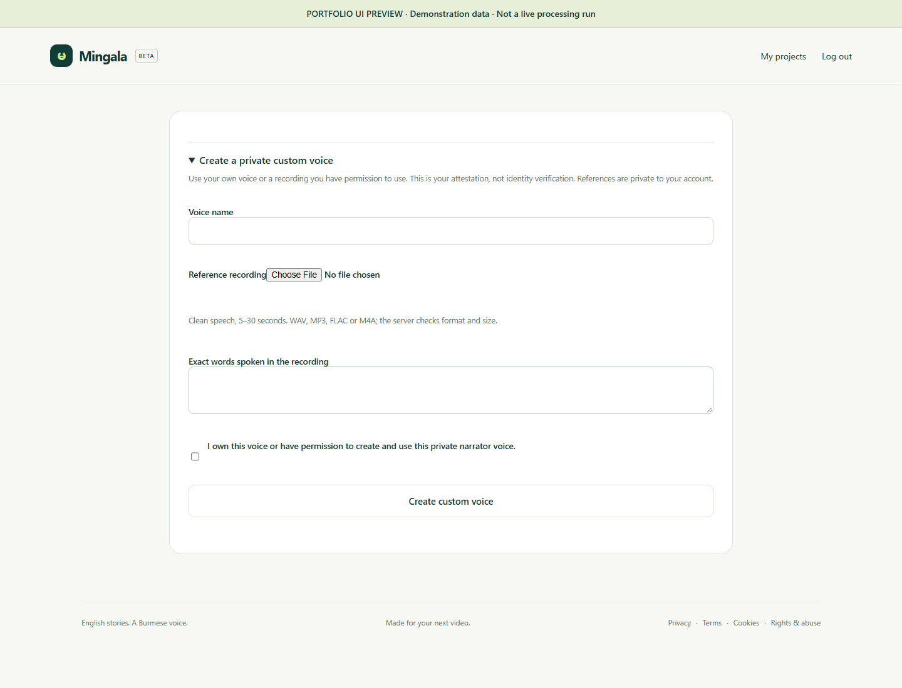
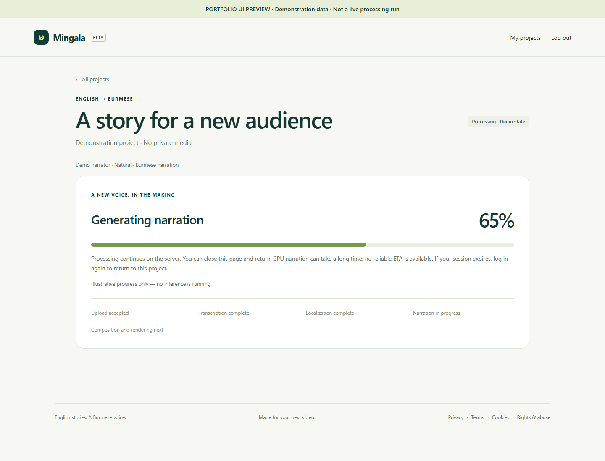
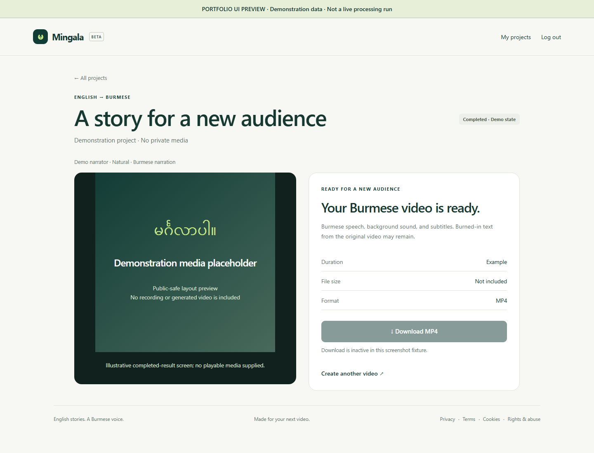
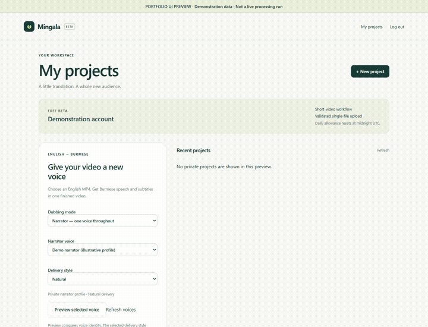

# Public-safe product screenshots

[Back to overview](../README.md)

Captured31October2026 from the current frozen HTML/CSS frontend in an isolated headless browser. These are newly rendered screenshots, not copied private verification exports.

## What the images represent

- Actual product frontend markup and styling, rendered read-only.
- A visible portfolio-preview label on the pages; generic demo account, narrator and project text only.
- Opened/isolated configuration and custom-voice panels for readable captures. No production source changes.
- Progress and completion values are deliberate **demonstration fixtures**. No job ran to create these images.
- The result screen has a clearly labeled media placeholder, not a private recording or generated output.
- Custom voice fields are empty; no reference audio, real transcript, personal identity, consent submission or credentials are shown.
- No backend/API requests, model loading, AI inference or authentication were used for the captures.

## Gallery

### Home

### Dashboard and narrator selection

### Subtitle and branding configuration
[Open the full-height configuration screenshot](configuration.png). It shows the existing font, size, color, position, watermark and blur controls; it is not a claim that a new render used those settings.

### Authorized custom voice workflow

### Processing progress

### Completed-result layout

### Short UI walkthrough

This GIF simply sequences still screenshots. It is not a recording of live interactions, a model-performance benchmark or audio-quality evidence.

## Still missing

A public-safe real narrated video/audio demonstration requires separate approval covering source media, generated content and speaker/voice publication rights. No such media was copied automatically. The architecture diagrams remain available as Mermaid in the documentation.

## Before adding more assets

Confirm publication rights; use demonstration account details; remove personal data, credentials, internal addresses and developer tools; review every frame and audio track; remove unnecessary metadata; label synthetic narration where appropriate. A screenshot does not grant rights to distribute its underlying media/reference.
