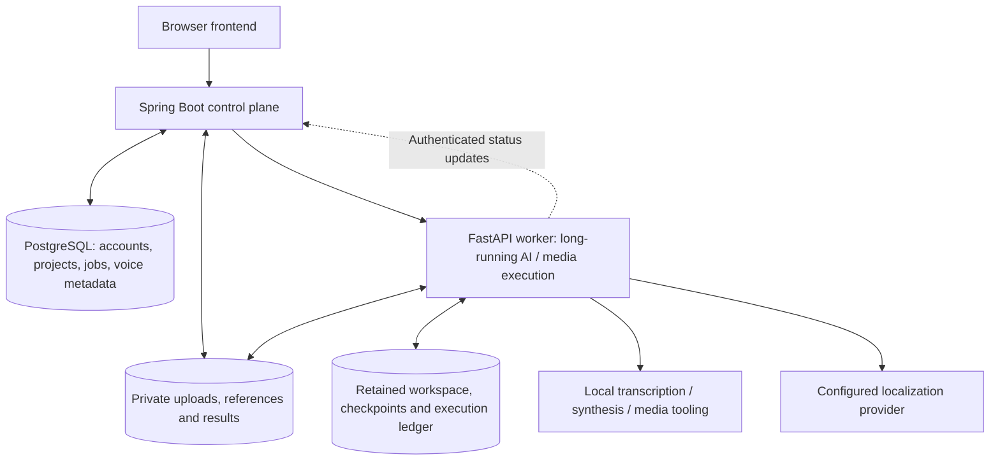

# Architecture

[Back to overview](../README.md)

This describes the implemented private application at its frozen pre-release state. It deliberately omits source code, prompts, configuration values, endpoint details and operational identifiers.

## Service boundaries

### Frontend

The HTML/CSS/JavaScript frontend supports sign-in, project creation, a single video upload, narrator/voice/style selection, custom-voice consent/upload, visual configuration, progress and protected result access. It communicates with the backend; it does not choose model repositories or receive internal service credentials.

### Spring Boot backend

The Java control plane owns account authentication, ownership checks, project and voice metadata, upload contracts, processing-job state, quotas and worker dispatch. Database transactions and locking protect state changes where concurrent requests could otherwise create duplicate work or inconsistent originals.

### PostgreSQL and migrations

PostgreSQL stores relational account, project, job and voice metadata. Flyway provides versioned schema evolution. Media bytes and model weights are not stored as ordinary database records.

### Python worker

FastAPI accepts protected backend requests and coordinates transcription, localization, speech generation, synchronization and media composition. WhisperX performs transcription/alignment; Gemini supplies localization; VoxCPM supplies narration; FFmpeg/ffprobe support validation and audio/video processing.

This is an application worker, not a public arbitrary-model execution API.

## Job lifecycle

A project moves through an asynchronous job lifecycle: queued → processing stages → completed or failed. The browser observes persisted status rather than holding one HTTP request open for the full inference run.

Supported transient failures can resume through an authenticated retry flow. Attempt ownership, workspace compatibility and existing activity are checked before resumed work is accepted. Not every failure is retryable.

A dead worker is not assumed safe to restart automatically merely because time has elapsed. Some interrupted-processing cases still require scoped operator handling.

## Storage and ownership boundaries

- Original uploads belong to their project owner.
- Custom voice references and previews are private to their owner.
- Intermediate artifacts and recovery state belong to a processing context.
- Final results are served through authorized access, not public media links.
- Trusted model assets are separate from user upload paths.

Storage abstractions support local persistent media and private object storage. Existing recovery depends on a compatible retained workspace; cross-machine hydration and distributed execution leases are not claimed as implemented.

## Why Java and Python?

Spring Boot fits the relational domain, transactional state, authorization and API orchestration. Python fits the native ML ecosystem and audio/media tooling. Keeping these responsibilities separate makes their security boundaries and resource demands explicit without rebuilding ML libraries in Java.

## Current deployment model

Docker/Compose definitions and single-server beta preparation exist. The application has not been declared publicly deployed. Final accepted images, actual server persistence, HTTPS and a fresh server E2E are still gates.

Separating lightweight web/control-plane resources from expensive inference is an evaluated deployment option, not an already-operated distributed GPU platform. No production-scale throughput claim is made.
