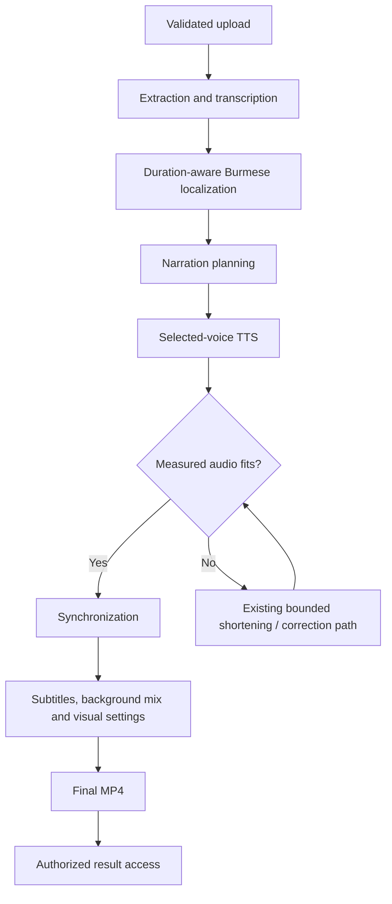

# Processing pipeline

[Back to overview](../README.md)

## From upload to result

| Stage | Responsibility |
|---|---|
| Upload | Authenticate the owner, enforce exactly one original video and validate actual media content and limits. |
| Audio extraction | Prepare audio from the accepted source without replacing the original upload. |
| Transcription | Obtain timed speech text through WhisperX. |
| Burmese localization | Preserve source meaning while producing natural Burmese; narrator mode receives a timing target. |
| Narration planning | Group localized content into narration units with playback budgets. |
| Narration generation | Use the selected built-in or authorized custom voice consistently for the job. |
| Synchronization | Measure generated audio, determine whether it fits under the existing timing policy, and align it to the source timeline. |
| Subtitles | Generate timed Burmese subtitle artifacts and apply supported presentation settings. |
| Background handling | Separate/preserve background material and mix narration according to the media path. |
| Visual composition | Apply configured subtitles, watermark and blur. These are presentation tools, not copyright clearance. |
| Rendering | Produce and technically validate the final MP4. |
| Publication | Make the result available through owner-authorized preview/download. |

The diagram abstracts implementation details; it is not a specification of private prompts, correction heuristics or model settings.

## Meaning and duration

Timing-aware localization treats duration as guidance, not an exact prediction of speech length. Conciseness must not silently remove important facts such as currencies, quantities or negation. Lightweight factual advisories flag suspicious omissions; they are not a complete semantic validator.

A conservative duration estimator is advisory. Final decisions use the actual generated WAV. Existing measured-fit logic stops further corrections when audio can already synchronize under the permitted policy. Exact final timing checks still apply.

## Voice identity and authorization

Built-in profiles and owner-scoped custom profiles resolve through the existing voice abstraction. Custom voices use authorized reference conditioning, not user-triggered model training. Consent is an affirmative user attestation; the system does not claim biometric or legal verification.

Narrator identity/style remain fixed across the job's units. Preview and cache behavior avoid unnecessary repeated synthesis where compatible results exist.

## Reliability and recovery

Provider errors are classified internally rather than inferred from public error text. Supported transient failures receive bounded retry/fallback handling; external errors remain sanitized.

Successful expensive work is persisted before later work starts where required. Recovery checks compatibility before reusing artifacts:

- Completed extraction and transcription can survive later localization failure.
- Compatible localized text and initial TTS can survive later correction failure.
- Completed corrections and synchronized units can be reused independently.
- Missing, corrupted or incompatible artifacts are not treated as successful work.

Compatibility fingerprints represent material inputs. A matching filename alone is insufficient. Checkpoints and an execution ledger preserve operation status, timing and reuse evidence without publishing private payloads.

## Limits of recovery

Retained compatible workspace and storage are required. Public retry eligibility, ownership, state and concurrency guards remain authoritative. Recovery does not mean unlimited retries, automatic failover or distributed-worker portability.

No public runnable pipeline, proprietary prompts, exact compatibility recipe or model artifacts are included in this showcase.
